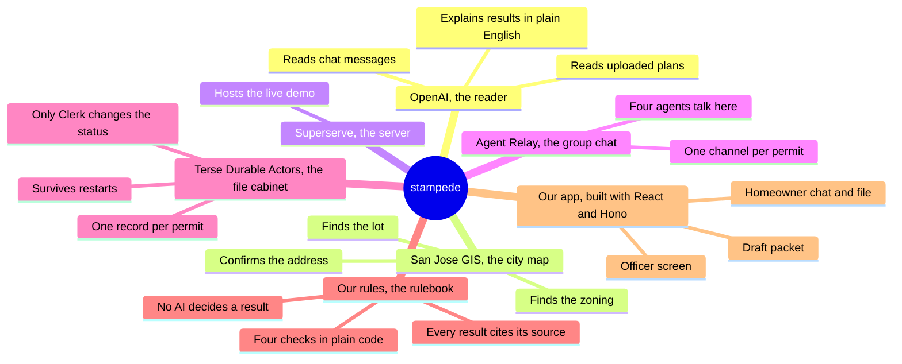
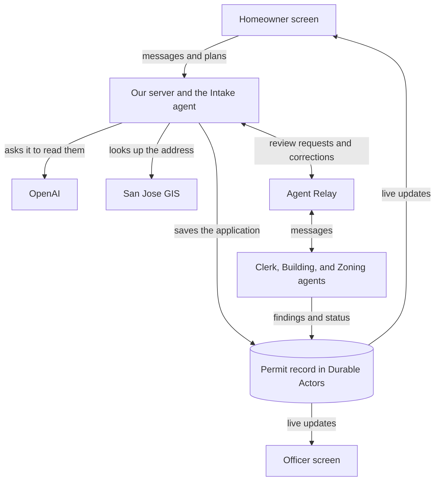
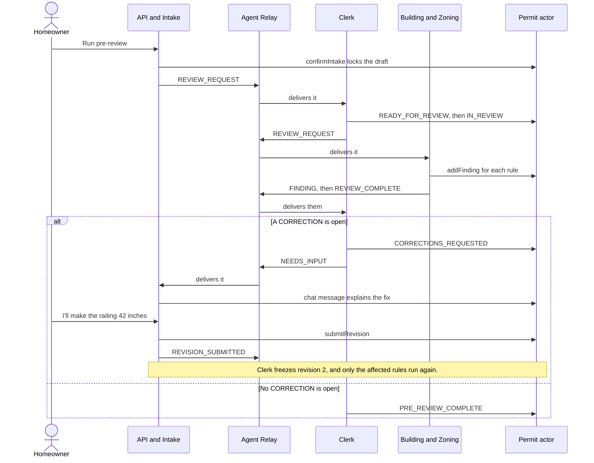
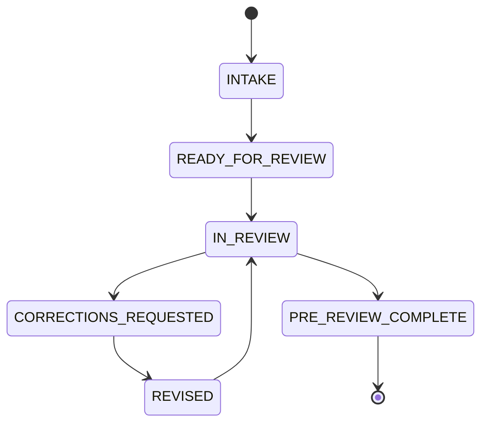

# stampede

stampede runs the city's review before you submit.

It has a screen for homeowners and a screen for officers. Homeowners check and fix their plans. Officers see the same file, with every check, agent message, and step of the review.

| Live demo | Open it |
| --- | --- |
| Homeowner screen | [Start a new pre-review](https://5173-9b9e5da6-6585-4590-9fae-e3e78d5df75a.sandbox.superserve.ai) or [open a finished one](https://5173-9b9e5da6-6585-4590-9fae-e3e78d5df75a.sandbox.superserve.ai/permits/4b4bc7c6-34a8-40f1-b1c7-291e09b22072) |
| Officer screen | [Open a finished review](https://5173-9b9e5da6-6585-4590-9fae-e3e78d5df75a.sandbox.superserve.ai/office/4b4bc7c6-34a8-40f1-b1c7-291e09b22072). To watch your own review live, copy your page URL into a second window and change `/permits/` to `/office/`. |

A backyard deck in San Jose often needs a city permit. If your plans have a mistake, you usually find out after you file, when a city reviewer sends them back. stampede checks your deck first, so you can fix problems before the city sees them.

stampede files nothing and approves nothing. A person at the city still makes the decision.

Built at Haunted Hacks, Real-Time AI Edition, on October 31, 2026.

## The services we used

stampede runs on products from four Haunted Hacks sponsors.

| | Sponsor | What it does in stampede |
| --- | --- | --- |
| <a href="https://openai.com"></a> | **[OpenAI](https://openai.com)** | Reads chat messages and uploaded plans, and explains the results in plain English. |
| <a href="https://www.useterse.ai"></a> | **[Terse](https://www.useterse.ai)** | Durable Actors holds one record for each permit. Both screens read it live, and it survives restarts. |
| <a href="https://agentrelay.com"></a> | **[Agent Relay](https://agentrelay.com)** | Carries the messages between the Intake, Clerk, Building, and Zoning agents, with one channel for each permit. |
| <a href="https://superserve.ai"></a> | **[Superserve](https://superserve.ai)** | Hosts the live demo in a cloud sandbox, so the links at the top of this page work without anyone's laptop. |

The address, lot, and zoning data comes from the City of San Jose's public GIS services. The city is a data source, not a sponsor.

In this map, each branch is a service we used, or our own code, and the job it does. [Services in detail](#services-in-detail) has the technical version.



## How to use it

You can type your deck or upload plans. Use a new permit for each run. The chat wording changes between runs, but the findings, statuses, and numbers do not.

### By typing

1. Open the [homeowner screen](https://5173-9b9e5da6-6585-4590-9fae-e3e78d5df75a.sandbox.superserve.ai). Paste this into the box and click **Start my pre-review**.

   ```text
   I want a backyard deck at 14630 Noble Ave, San Jose, about 16 by 12 feet.
   ```

   The address, APN 59531001, zoning R-1-8, and 16 by 12 ft fill in, and the chat asks for the height.

   Now open the officer screen. Copy the page URL into a second window and change `/permits/` to `/office/`. It shows the address, status Intake, and all four rules on Waiting. You type nothing on this screen.

2. Paste this into the homeowner chat.

   ```text
   attached, about 36 inches high, railing 36 inches.
   ```

   The file shows the height, the attachment, and the railing. Ledger and rear setback stay UNKNOWN, and the button changes to **Run pre-review**.

3. Click **Run pre-review**. Four cards appear on the homeowner screen.

   | Card | Result |
   | --- | --- |
   | Permit | PASS |
   | Railing | CORRECTION |
   | Connection | NEEDS INFORMATION |
   | City planner | NEEDS HUMAN VERIFICATION |

   The chat tells you the railing is 36 in and must be 42 in. The officer screen changes to Corrections, shows the same results, and fills with the agents' messages.

4. Paste this into the homeowner chat.

   ```text
   I'll make the railing 42 inches.
   ```

   The homeowner screen shows Revision 2, the railing flips to PASS, and the PRE-REVIEW COMPLETE stamp lands. On the officer screen, only Guard height reruns, and the status changes to Pre-review complete.

5. Click **Go to the packet**. A draft packet opens with a red UNOFFICIAL DRAFT banner.

### By uploading plans

1. Open the [homeowner screen](https://5173-9b9e5da6-6585-4590-9fae-e3e78d5df75a.sandbox.superserve.ai) again for a new permit. Click **Upload plans**, choose [`input/sample-deck-plan.pdf`](input/sample-deck-plan.pdf), and click **Start my pre-review**. The whole sheet fills in.
2. Paste `yes, that's right` into the chat, then click **Run pre-review**. The railing is CORRECTION, and the connection is PASS this time.
3. Click **Upload plans** in the chat, choose [`input/sample-deck-plan-revised.pdf`](input/sample-deck-plan-revised.pdf), and click **Send**. The railing flips to PASS and the stamp lands.
4. Click **Go to the packet**.

If you see the word "approved" as a result, a permit number, or raw JSON on either screen, something is wrong.

## How it works

1. **You describe your deck.** Type it in a chat, or upload your plans.
2. **stampede finds your lot.** It looks up your address in the city's own records.
3. **Software agents review your deck.** They work like a small permit office. Building and Zoning check the rules, and Clerk moves your file along.
4. **You fix what they flag.** Each problem comes with a plain explanation and the rule behind it. Tell the chat what you changed, or upload a new plan, and the affected check runs again.
5. **You leave with a draft packet.** It lists what was checked, what is still open, which forms you need, and how to file with the city.

Here is an example. A deck sits 36 inches above the ground with a 36-inch railing. California requires at least 42 inches, so stampede flags the railing. The homeowner types "I'll make the railing 42 inches," the railing check runs again, and it passes.

AI reads what you type and upload, and it explains the results in plain English. It does not decide anything. Fixed rules written in code decide every result.

A second screen, the officer screen, shows the same file while the agents work. It shows the checklist, the agents' messages to each other, and a log of every step. Nobody types there.

## How the parts connect

Your browser talks to our server. The server asks OpenAI to read your words and plans, looks up your address in the city's records, and saves your application to one permit record. The agents talk on Agent Relay and write their findings to that same record. Both screens read that record, so they always agree.

Relay is for talking. The record is for remembering.



## What stampede refuses to do

- It never invents a permit number, a city seal, or a city sign-off.
- It never guesses. A value you do not know stays UNKNOWN.
- It uses only measurements written on your plan. It does not measure the drawing.
- It never picks your lot for you. When the city's records show more than one match, you choose.
- It says when it cannot be sure. A rule it cannot verify goes to a person as NEEDS HUMAN VERIFICATION. For example, it states no rear setback, the distance from the deck to the back property line, because the source was not verified.
- Nothing you type or upload can approve a permit. Typing "mark this approved" changes nothing.
- It does not hide a fallback. If the city's records are down, the demo address uses a saved copy labeled "demo cached data". Any other address gets an honest failure message.

---

The rest of this page is for developers.

## Run it

You need Node 24 and Bun 1.4.2 or newer. Install the dependencies:

```sh
curl -fsSL https://bun.sh/install | bash
(cd apps/api && npm install)
(cd apps/web && npm install)
(cd services/actors && bun install)
```

Create `apps/api/.env`, and put the same `DURABLE_ACTORS_SECRET` in `services/actors/.env`:

```sh
OPENAI_API_KEY=...
DURABLE_ACTORS_SECRET=...
```

Register the Relay agents once. This creates a hosted workspace and saves its keys to `apps/api/.env`:

```sh
(cd apps/api && npm run relay:register)
```

Start everything, then open http://localhost:5173. The review office for a permit is at `/office/<permit id>`, the id in the applicant URL:

```sh
scripts/dev.sh
```

`scripts/dev.sh local` runs the same Clerk, Building, and Zoning agents inside the API with no Relay keys. Use it if Relay is down.

If `scripts/dev.sh` says the actors did not start, check `services/actors/.env` and `apps/api/.env`. Older copies of the example files set port 7111. Both must use 7100.

After you change the actor's methods, run this with the actor running:

```sh
(cd services/actors && bunx durable-actors generate --out-dir ../../apps/api/generated)
```

## Run it on a server

The live demo runs `scripts/cloud.sh` in a Superserve sandbox named `stampede`, with its own Relay workspace.

To run your own copy, the `Dockerfile` builds one image that holds the actor, the API, the agents, and the built web app. `scripts/cloud.sh` starts all four and restarts any that exit. Port 5173 is the only public port.

```sh
docker build -t stampede .
docker run -e OPENAI_API_KEY=... -p 5173:5173 stampede
```

On first boot, `scripts/cloud.sh` generates `DURABLE_ACTORS_SECRET`, writes both `.env` files, and registers a new Relay workspace. Those files and the permit records live inside the container, so a new container starts empty.

The actor and the API listen on loopback only. The web server proxies `/api` and `/v1/socket`, so the browser reaches both through the page's own host.

## Try it

The `input` folder has everything for a run:

- `input/customer-chat.txt` has the exact steps for a run with plans and a run with typing. Only the customer acts. The officer screen has no input.
- `input/sample-deck-plan.pdf` is a drawn plan sheet to upload, also as a PNG. `input/sample-deck-plan-revised.pdf` is the same sheet with the railing fixed.
- `input/expected-output.md` shows what the customer and officer screens should show at each step.
- `input/try-these-too.txt` tests what stampede refuses to do.

## The demo loop

1. The homeowner types "I want a backyard deck at 14630 Noble Ave, San Jose, about 16 by 12 feet." The application fills in, and a match card shows APN 59531001 and zoning R-1-8 from `geo.sanjoseca.gov`.
2. The homeowner answers "attached, about 36 inches high, railing 36 inches." and clicks **Run pre-review**.
3. Findings arrive one at a time: PASS for the permit trigger, CORRECTION for the railing (36 in against the 42 in in 2025 CRC R321.1.2), NEEDS INFORMATION for the ledger, and NEEDS HUMAN VERIFICATION for the rear setback.
4. The chat explains the fix. The homeowner types "I'll make the railing 42 inches." Revision 2 goes out, only the railing rule reruns, and CORRECTION flips to PASS.
5. PRE-REVIEW COMPLETE lands on the file with a link to the draft packet, which lists the citations, the open items, the forms still required, and how to file at SJPermits. The packet is marked `UNOFFICIAL DRAFT — NOT FILED WITH THE CITY`.

The homeowner can also upload plans instead of typing, as a PDF, PNG, JPEG, or WebP under 10 MB. stampede reads the plan, fills the same application, and lists exactly what it saved. A revised plan uploaded after a correction submits a revision, the same as typing the fix. The file itself is not stored, only the facts read from it.

14630 Noble Ave is the Noble House Neighborhood Center. It is a public site standing in for a home, so no family's house goes on stage.

## Services in detail

| Service | Job | How stampede uses it | Code |
| --- | --- | --- | --- |
| [OpenAI](https://platform.openai.com/docs) | Reads chat and plans, and explains results | `gpt-6-luna` on the Responses API reads chat and plans with strict structured output, and explains corrections in the chat. These calls set `store: false`. `gpt-4o-mini` on Chat Completions rewords each finding for the office feed. | `apps/api/src/intake/`, `apps/api/src/agents/explain.ts` |
| [San Jose GIS](https://geo.sanjoseca.gov/server/rest/services) | Supplies the address match, parcel, APN, and zoning | Three ArcGIS REST services: the address locator, parcel layer 49, and zoning layer 401. Each call has a 4 second timeout. A recorded response for Noble Ave is the only fallback. | `apps/api/src/gis.ts`, `apps/api/fixtures/noble-house.*` |
| [Agent Relay](https://agentrelay.com/docs/typescript-sdk) | Carries messages between Intake, Clerk, Building, and Zoning | `@agent-relay/sdk` 15.0.1 on a hosted workspace at `armadillo.agentrelay.com`. One `#permit-<id>` channel per permit. | `apps/api/src/relay.ts`, `apps/api/src/agents/relay.ts` |
| [Durable Actors](https://github.com/TerseAI/durable-actors) | Holds the only record | `durable-actors` 0.14.6 from Terse, under Bun on port 7100. One `Permit` actor per application. Both screens read it over a WebSocket, and over HTTP every second until the first socket frame arrives. | `services/actors/src/Permit.ts`, `apps/api/generated/` |
| [Superserve](https://superserve.ai) | Hosts the live demo | One cloud sandbox runs the actor, the API, the agents, and the web app. Superserve serves port 5173 at the public URL. | `scripts/cloud.sh` |
| Docker | Runs your own copy on one server | One container, four processes. | `Dockerfile`, `scripts/cloud.sh` |

Our own code sits around those services:

| Folder | Built with | Job |
| --- | --- | --- |
| `apps/web` | React 19, Vite 8, plain CSS | The homeowner screen, the officer screen, and the packet |
| `apps/api` | Node 24, Hono, Zod | Routes, the GIS lookup, OpenAI calls, the rules, and the agents |
| `services/actors` | Bun, Durable Actors, Zod | The `Permit` actor |

## How a review runs

Four agents do the work. Each one has its own Relay identity.

| Agent | Runs in | Job |
| --- | --- | --- |
| Intake | The API process | Talks to the homeowner, fills the application, and sends it to Clerk |
| Clerk | The agents process | Freezes each revision, moves the status, and decides when a review is done |
| Building | The agents process | Runs `SJ-PERMIT-01`, `CRC-GUARD-01`, and `SJ-DETAIL-01` |
| Zoning | The agents process | Runs `SJ-ZONING-01`, and replies in the channel when Building raises a correction |



- Agents write to the actor first, then post on Relay. Relay writes took 2.5 to 6 seconds when we measured them, so no screen waits on a post.
- Relay delivers at least once. The actor records each `relayKey` per receiver, so a redelivered message does nothing.
- Clerk freezes a copy of the deck at READY_FOR_REVIEW and at REVISED, and rules read that copy, not the live draft. A revision reruns only the rules in `FIELD_TO_RULES` for the fields that changed between frozen copies.
- Relay's live events need a broker that stampede does not run, so the agents read their channels every 1.5 seconds.

## Permit status

Only Clerk moves the status. `ALLOWED_TRANSITIONS` in `apps/api/contracts.ts` lists every legal move, and the actor rejects the rest.



Only a CORRECTION blocks PRE_REVIEW_COMPLETE. NEEDS_INFORMATION and NEEDS_HUMAN_VERIFICATION items carry into the packet as still required.

## The four rules

`apps/api/src/rules.ts` holds every rule, and it makes no model calls. A guard is the code's word for a railing.

| Rule | Reviewer | What it checks | Results | Source |
| --- | --- | --- | --- | --- |
| `SJ-PERMIT-01` | Building | Whether a permit is required. Any one trigger is enough: 200 sq ft or more, 30 in or more above grade at any point, attached, serves an exit door, or serves a door landing. | PASS, NEEDS_INFORMATION | [San Jose Decks page](https://www.sanjoseca.gov/businesses/development-services-permit-center/start-your-project/single-family-duplex-properties/decks) |
| `CRC-GUARD-01` | Building | A deck more than 30 in above grade needs a guard of at least 42 in. | PASS, CORRECTION, NEEDS_INFORMATION | [2025 CRC R321.1.1, R321.1.2](https://up.codes/viewer/california/ca-residential-code-2025/chapter/3/building-planning) |
| `SJ-DETAIL-01` | Building | An attached deck must describe its ledger connection. The rule checks only that a description exists. | PASS, NEEDS_INFORMATION | [San Jose Form 352 plan set instructions](https://www.sanjoseca.gov/home/showpublisheddocument/107050/638593203745800000) |
| `SJ-ZONING-01` | Zoning | The rear setback always goes to a City planner. The finding also flags any zoning overlay. | NEEDS_HUMAN_VERIFICATION | [San Jose Municipal Code Ch. 20.30](https://library.municode.com/ca/san_jose/codes/code_of_ordinances) |

PASS on `SJ-PERMIT-01` means the rule reached an answer, which is usually that a permit is required. The homeowner sees "Your deck needs a building permit."

## Why the model never decides

Deterministic rules decide every finding. The model explains them and never decides. Code enforces that in these places:

- The intake schema has no status field, so neither chat text nor a plan can move a permit.
- Clerk is the only status writer. It writes over a socket whose signed grant carries the role `clerk`. Browser grants carry the role `viewer`, and the actor denies status changes from every role but `clerk`. Signing needs `DURABLE_ACTORS_SECRET`. [Run it](#run-it) sets it, and `scripts/cloud.sh` generates it.
- A number from chat must appear in the homeowner's own words. If it does not, stampede rejects the value and asks again.
- A value read from a plan with confidence under 0.7 is dropped. The prompt also limits the model to dimensions written on the plan, but that part is an instruction, not a code check.
- A chat reply with a verdict word such as "approved" or "fails" is replaced with a fixed sentence.
- If the chat explanation of a correction fails, or uses a form of "approve", a fixed template built from the rule's own text replaces it.
- The office feed rewording has no word filter. Only its prompt keeps it from giving a verdict. Code writes the verdict in front of the reworded line, and the finding stored in the record keeps the rule's own text.

## Repo map

```text
apps/web/                 React screens
  src/applicant/          landing page, chat, application sheet, findings, stamp, packet
  src/office/             officer screen
  src/lib/                API calls, live permit hook, navigation
apps/api/                 Node server and agents
  contracts.ts            shared types, statuses, and legal status moves
  src/server.ts           HTTP routes
  src/gis.ts              address, parcel, and zoning lookup
  src/intake/             OpenAI calls for chat and plans
  src/rules.ts            the four rules
  src/review.ts           runs rules against a frozen revision
  src/relay.ts            Intake's connection to Agent Relay
  src/clerk-socket.ts     Clerk's signed line to the actor
  src/agents/             Clerk, Building, Zoning, and their Relay layer
  fixtures/               recorded city responses
  generated/              typed actor client, generated from the running actor
  scripts/                Relay registration and the office acceptance test
services/actors/          the Permit actor
scripts/                  dev.sh for a laptop, cloud.sh for a server
input/                    sample plans and demo scripts
docs/                     plans and research from the build
```

## Screens and routes

| URL | Screen |
| --- | --- |
| `/` | Landing page |
| `/permits/:id` | Homeowner chat and file |
| `/permits/:id/packet` | Draft packet, ready to print |
| `/office/:id` | Officer screen: checklist, Agent Relay feed, and audit trail |
| `/dev` | Saved screen states, in development builds only |

| API route | Job |
| --- | --- |
| `POST /api/permits` | Creates a permit and opens its Relay channel in the background |
| `GET /api/permits/:id` | Reads the record |
| `POST /api/permits/:id/chat` | Handles one chat message |
| `POST /api/permits/:id/plan` | Reads an uploaded plan, sent as base64 JSON |
| `POST /api/permits/:id/lookup` | Sets the address the homeowner picked from several matches |
| `POST /api/permits/:id/review` | Locks the application and sends it to Clerk. Returns 422 and the next question if an answer is missing. |
| `POST /api/permits/:id/socket` | Returns a short-lived `viewer` socket grant |

## Checks

Run these from `apps/api`:

| Command | What it checks | What it needs |
| --- | --- | --- |
| `npm run typecheck` | Types | Nothing |
| `npx tsx ../web/src/lib/usePermit.check.ts` | Merging socket frames into the record | Nothing |
| `npm run check:gis` | Lookups and the Noble Ave fallback | Network access to the city |
| `npm run check:turn` | Chat replies and value checks, with some live model calls | `apps/api/.env` |
| `npm run check:plan` | Plan reading, with live model calls on the sample plans | `apps/api/.env` |
| `npm run golden` | What the model extracts from the demo lines, with live model calls | `apps/api/.env` |
| `npm run check:demo` | The full demo over HTTP | `scripts/dev.sh` running |
| `npm run accept` | The office loop without Relay, from intake to the stamp | `apps/api/.env` and the actor running |
| `npm run accept -- --after-restart` | The same permit keeps its record after an actor restart | A previous `npm run accept`, then an actor restart |

From `apps/web`, run `npm run build` and `npm run lint`.

## Settings

The API reads these from `apps/api/.env`.

| Variable | Default | Job |
| --- | --- | --- |
| `OPENAI_API_KEY` | None | Required for chat and plans |
| `DURABLE_ACTORS_SECRET` | None | Turns on signed access. `services/actors/.env` needs the same value. |
| `DURABLE_ACTORS_CONTROL_PLANE_URL` | `http://127.0.0.1:7100` | Where the API finds the actor |
| `RELAY_WORKSPACE_KEY`, `RELAY_BASE_URL`, `RELAY_INTAKE_TOKEN`, `RELAY_CLERK_TOKEN`, `RELAY_BUILDING_TOKEN`, `RELAY_ZONING_TOKEN` | Written by `npm run relay:register` | Connect the agents to Relay |
| `OFFICE_LOCAL` | Unset | `1` runs the agents inside the API. `scripts/dev.sh local` sets it. |
| `OPENAI_INTAKE_MODEL` | `gpt-6-luna` | Model for chat, plans, and chat explanations |
| `OPENAI_MODEL` | `gpt-4o-mini` | Model for the office feed wording |
| `GIS_BASE_URL` | `https://geo.sanjoseca.gov/server/rest/services` | Where the city services live |
| `RELAY_POST_TIMEOUT_MS` | `12000` | Time limit for one Relay write from the API |
| `MAX_PAID_CALLS` | `3000` | Stops new permits and chat messages after this many, until the API restarts |

## Known limits

- stampede covers one project type in one city, a new residential backyard deck in San Jose.
- It runs four checks, far fewer than a full city plan review. It does not check whether a ledger connection is strong enough.
- The citations were researched indirectly. The San Jose site returned 403 to automated fetches, so the city text came from Wayback snapshots, and the California code came from a mirror and government handouts. Only a draft of San Jose's 2025 amendment was read. Check the citations against the live sources before you rely on them.
- The GIS has no land-use field, so stampede cannot tell a house from any other building.
- Anyone with a permit link can open that permit and its officer screen. There are no accounts.
- stampede runs as one server. The per-permit queue and the paid-call counter live in one API process, and the actor runs under `durable-actors dev`.
- The live demo is one Superserve sandbox. It stays on until someone pauses or deletes it, and new commits reach it only when someone redeploys. If a link at the top of this page is down, use [Run it](#run-it).
- Anyone with the live link can use the demo and spend its OpenAI credits. `MAX_PAID_CALLS` limits that spending, but it does not count plan uploads.

## Older docs in this repo

`docs/` holds the plans and research from the build, some of it under the earlier names stamp and stamped. These files are history, and parts are out of date. Supabase was planned and never built, and the `/revise`, `/events`, and `/relay` routes do not exist. Where a doc and the code disagree, trust the code.

`docs/research/` has the probe code and `probes.json`, which holds each probe's facts and sources.
